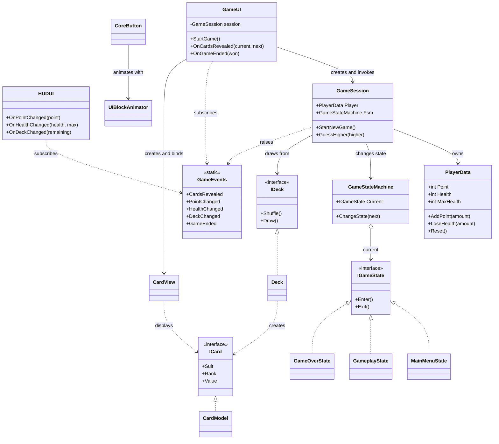

# Higher or Lower Card Game

A small Unity card game in which the player predicts whether the next card has a higher or lower rank than the current card. The project is built with Unity 6.2 and uses Nova UI components.

## Run the project

1. Install **Unity 6.2.6f2** (editor version `6000.2.6f2`) through Unity Hub.
2. Open the Unity project folder (the one containing `Assets`, `Packages`, and `ProjectSettings`).
3. Let Unity resolve the packages listed in `Packages/manifest.json`. The project uses Nova UI assets included in `Assets/Nova`.
4. In the Project window, open `Assets/_Projects/Scenes/SampleScene.unity`.
5. Press **Play**. Use the start button, then choose **Higher** or **Lower** for each next card. The round ends when the configured number of cards is dealt or the player's health reaches zero.

The sample scene configures `GameUI` to deal five cards. The `cardCount` field can be changed on the `GameUI` component in the Inspector.

## Code organization

Scripts are grouped by responsibility under `Assets/_Projects/1. Scripts`:

- **Game** — `GameSession` coordinates a round, `PlayerData` stores score and health, `GameStateMachine` manages state transitions, and `GameEvents` publishes presentation updates.
- **Deck** — `Deck` implements `IDeck` and supplies a shuffled standard deck of `ICard` models.
- **Card** — `CardModel` stores rank and suit; `CardView` binds a model to its card sprite and controls whether it is revealed.
- **UI/Panel** — `GameUI` owns the session and menu/card/game-over flow; `HUDUI` listens for events and updates score, health, and remaining cards.
- **UI/Element** — `CoreButton` adapts Nova interaction gestures into UnityEvents; `UIBlockAnimator` supplies reusable visual animations.

## Architecture

The gameplay model is kept separate from its Unity/Nova presentation. `GameSession` applies guesses, updates `PlayerData`, and raises `GameEvents`; UI components subscribe and render those changes. `GameUI` also translates button clicks into session actions. The state machine models the menu, gameplay, and game-over lifecycle; the menu panels themselves are currently switched directly by `GameUI`.

